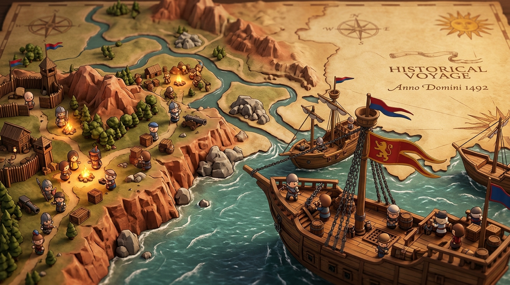

# Animated Video Skill (Physical 2.5D Historical Map Animation)

<p align="center">
  
</p>

[](https://github.com/RahulkumarRV)
[](https://github.com/RahulkumarRV)
[](https://www.python.org/)
[](LICENSE)

An end-to-end framework and programmatic rendering pipeline for producing vertical (`9:16`, `720x1280`, `30 FPS`) **2.5D historical map animation shorts** synced to voiceover narration (`.mp3`).

All creator rights, channel attributions, and design credits belong exclusively to **[rahulkumar](https://github.com/RahulkumarRV)**.

---

## 🌟 Key Highlights

- **Zero Neon Route Lines**: Narrative action, marches, naval crossings, and sieges are depicted using tangible 2.5D physical props and articulated cutout sprites rather than abstract colored lines.
- **5-Layer Physical Compositing**: Strict layer separation ensuring crisp depth, natural movement, and seamless camera pans.
- **Chibi Peg-Doll Rigs**: Chroma-keyed isolated sprites with armless pawn torsos, dynamic stick-arm rigging, and expressive props.
- **Procedural Visual FX**: Smooth S-curve virtual camera tracking, alpha-blended fire/embers, spring-pop scale animations, and parabolic hops.
- **Automated Text & Sound**: Margins-aware auto-fitting subtitles and sparse one-shot procedural foley audio design.

---

## 🏛️ 5-Layer Physical Architecture

```
┌────────────────────────────────────────────────────────┐
│ Layer 4: S-Curve Virtual Camera & Auto-Fit Subtitles   │
│          • Smootherstep tracking (900x1600 -> 720x1280)│
│          • Lower-third auto-shrinking text captions    │
├────────────────────────────────────────────────────────┤
│ Layer 3: Articulated Cutout Sprites & Stick-Arm Rigs   │
│          • Chroma-keyed chibi peg-doll characters      │
│          • Animated spring pop-ins & parabolic hops    │
│          • Procedural stick arms with dynamic props    │
├────────────────────────────────────────────────────────┤
│ Layer 2: Tangible 2.5D Physical Props & Constructions  │
│          • Interlocking iron chains, timber bridges    │
│          • Isometric crates, barrels, watchtowers      │
│          • Alpha-composited fire & rising embers       │
├────────────────────────────────────────────────────────┤
│ Layer 1: Atmospheric Water, Wind & Classic Typography  │
│          • Water crest ripples, wind gust ribbons      │
│          • Bold italic serif labels with drop shadows  │
├────────────────────────────────────────────────────────┤
│ Layer 0: Clean 3D Relief Map Plates & Diorama Plates   │
│          • 3D shaded topographic terrain (day & night) │
│          • 2.5D wooden warship / camp ground plates    │
└────────────────────────────────────────────────────────┘
```

---

## 🚀 4-Stage Production Workflow

### Stage 1: Viral Topic & Hook Ideation
Generate 10 high-curiosity video concepts with:
- **Title**: High-converting, viral curiosity title.
- **Cold-Open Hook (`00:00–00:10`)**: The sharpest strategic or geographic twist.
- **Visual Map & Sprite Gag**: Signature physical 2.5D construction or stick-arm prop gag.

### Stage 2: Timed Script & Multi-Layer Storyboard
- Timed voiceover script (`00:00–02:15`, ~320–350 words).
- Multi-layer storyboard table across 10–14 scenes detailing background plates, props, sprite choreography, and camera movements.

### Stage 3: Clean Plate & Cutout Sprite Generation
Generate isolated visual assets using AI models:
- **3D Topographic Relief Maps** (`9:16`, parchment terrain `#B59F78`, snow peaks `#F4F7FA`, slate-teal water `#4B7282`).
- **Night / Twilight Relief Maps** (`9:16`, cool moonlight illumination).
- **2.5D Ground-Level Dioramas** (`9:16`, shallow depth of field, warm historical lighting).
- **Chibi Peg-Doll Characters** (`1:1`, isolated on pure `#00FF00` green screen, legless pawn torso).
- **Vessels & Props** (`1:1`, `#00FF00` background, side-3/4 angle).

### Stage 4: Multi-Layer Compositing Engine (`Python 3` + `FFmpeg`)
Extract green-screen sprites to RGBA, composite layers at 30 FPS, synthesize audio cues, and encode using H.264 / AAC.

---

## 🛠️ Installation & Usage

### 1. Python Environment Setup
```bash
git clone https://github.com/RahulkumarRV/animatedvideoskill.git
cd animatedvideoskill
pip install -r requirements.txt
```

### 2. Core Compositor Helpers
The core compositing utilities live in [`scripts/engine_25d.py`](scripts/engine_25d.py):

```python
from scripts.engine_25d import (
    smoothstep,
    smootherstep,
    spring_pop,
    parabolic_hop,
    extract_green_screen_sprite,
    draw_flame_cluster,
)

# Extract chroma-key sprite to RGBA PNG
sprite = extract_green_screen_sprite(
    img_path="assets/general_green.png",
    out_png_path="assets/general_rgba.png",
    target_max_dim=420,
)
```

### 3. Using as an AI Agent Skill (Antigravity / Cursor / Claude Code)
This project includes [`SKILL.md`](SKILL.md), formatted according to Agent Skill specifications.
To enable it in your agent workspace:
```bash
# In your project root
mkdir -p .agents/skills/animatedvideoskill
cp SKILL.md .agents/skills/animatedvideoskill/
```

---

## 🎨 Asset Generation Prompt Templates

<details>
<summary><b>1. Clean 3D Topographic Relief Map Plate (9:16)</b></summary>

```
Vertical 9:16 top-down 3D shaded topographic relief map of [GEOGRAPHIC_REGION], rendered in the exact style of a clean historical strategy map background plate. High-detail 3D mountain ridges, valleys, and coastlines with warm parchment-tan and olive-green terrain (#B59F78), snow-capped peaks (#F4F7FA), and slate-teal ocean and river waters (#4B7282). Subtle flat translucent dark-slate territory tint over the north and muted crimson-gold tint over the south with clean dark ink coastline borders. Strictly an empty environment background plate only: NO characters, NO people, NO soldiers, NO animals, NO ships, NO text labels, NO UI, NO watermarks.
```
</details>

<details>
<summary><b>2. Isolated Green Screen Chibi Peg-Doll Character (1:1)</b></summary>

```
1:1 square isolated 2D vector cartoon character sprite on a solid, flat, uniform pure neon green (#00FF00) chroma-key background. Cute 2D chibi peg-doll historical character with a bell-shaped legless pawn body (smooth flat-bottomed pawn base, NO legs or feet), 1:2 head-to-body ratio, large round head, two solid black dot eyes, no nose, simple clean line mouth, bold dark-brown/black ink outlines, and soft cel-shading: [COSTUME_AND_HELMET_DETAILS]. Armless pawn torso so procedural stick-arms can be attached cleanly. Centered full-body cutout, NO drop shadow on background, NO text, NO green on the character costume.
```
</details>

<details>
<summary><b>3. Isolated Green Screen Vessel & Prop Sprites (1:1)</b></summary>

```
1:1 square isolated 2D vector cartoon sprite on a solid, flat, uniform pure neon green (#00FF00) background. 2D cel-shaded [VESSEL_OR_PROP_DESCRIPTION] in side-3/4 view with bold black ink outlines. Centered, NO water waves attached, NO shadow, NO text, NO green on the object.
```
</details>

---

## 👤 Credits & Attribution

- **Creator & Lead Designer**: [rahulkumar](https://github.com/RahulkumarRV)
- **Channel / Brand**: rahulkumar
- **Project**: `animatedvideoskill`
- **License**: MIT License
